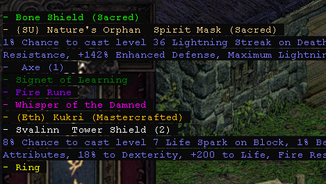

# D2Stats

## Features
- Read character/mercenary stats
- Check difference in stats between 2 states (Click 'Read' to snapshot stats. After modifying stats, click 'Diff' to compare without changing the snapshot, or 'Diff and replace' to compare and then overwrite the snapshot)
- Set up rule list that check drops and notify the user when matching one drops
- Play sound notification when goblin appears

[Forum post](https://forum.median-xl.com/viewtopic.php?f=4&t=85654)

## FAQ
### "Windows defender/Antivirus removes/quarantines the exe file. Is it a virus?"
This tool attaches itself to the `Game.exe` process and modifies memory to function properly. Due to this behaviour (and also frequent updates and small user pool) antivirus software label it as trojan. There is nothing i can do to fix it and i can only recommend to add .exe file to ignore/exception list.

### "Why can't i hide items using D2Stats?"
Mod version 2.10 introduced in-game loot filtering system that disabled filtering using D2Stats. Current version only allows for notifying when certain item drops. All filters that still have `hide` and `show` keywords need to have them removed for notifier to function properly

### "Why does the notifier overlay look so ugly. Can i modify it eg change font style or background transparency/color?"
The overlay is an ImGui layered window (per-pixel alpha) drawn by `d2stats_ui.dll`. Exposed options:
  - Font (Options combo of **monospace** fonts installed on this machine)
  - Font size
  - X and Y offset (in pixels) from top-left edge of the window
  - Notification timeout duration (in milisecond)
  - Contrast background behind overlay text

The font list comes from Windows/GDI, so Wine/Linux users only see fonts available in that Wine prefix. Install `corefonts` (`winetricks corefonts`) or copy `.ttf` files into Wine's `Fonts` folder if the combo is empty or missing Courier New / Consolas. Wine also needs a working D3D11 path (DXVK) for the overlay.

If you really want to change some properties that were not exposed on the application UI you'll have to edit the overlay/UI code (`native/d2stats_ui/` and `src/Overlay.au3`) and recompile it using provided script (`Compile.bat`)

## Layout
- `D2Stats.au3` — application entry point (keep at repo root so runtime files stay beside the exe)
- `src/` — feature modules (game memory, notifier, AutoIt bridge to ImGui)
- `native/d2stats_ui/` — Dear ImGui settings window and transparent overlay (`d2stats_ui.dll`, 32-bit)
- `Sounds/` — notifier audio, shipped next to the exe
- `Assets/` — icon and README screenshots
- `vendor/` — bundled AutoIt interpreter, compiler, and UDFs
- `tools/` — version stamp, release packaging, and speedcalc data update

Building requires CMake and a 32-bit MSVC toolset in addition to AutoIt. `Compile.bat` builds `d2stats_ui.dll` then `D2Stats.exe`. Ship both next to `Sounds/`.
