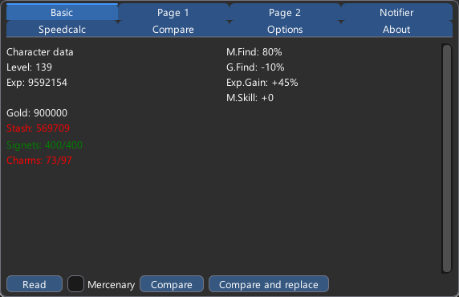
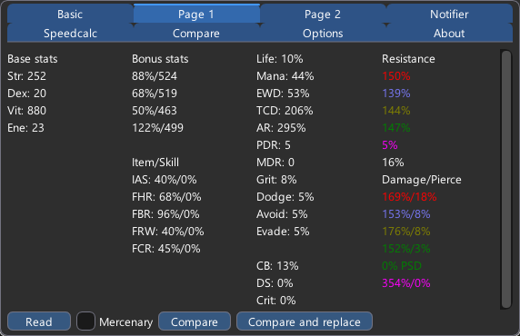
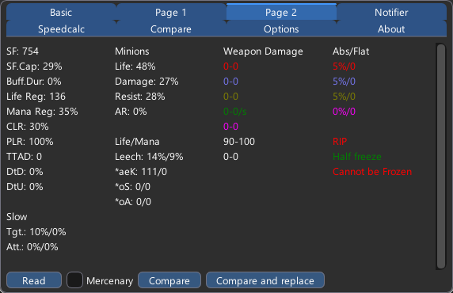
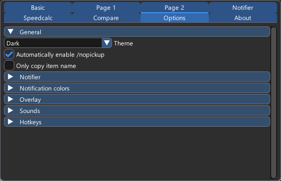
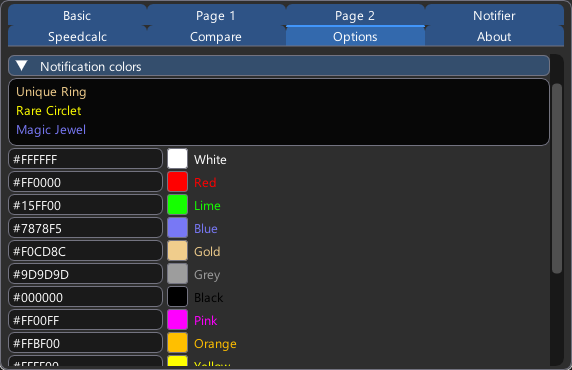
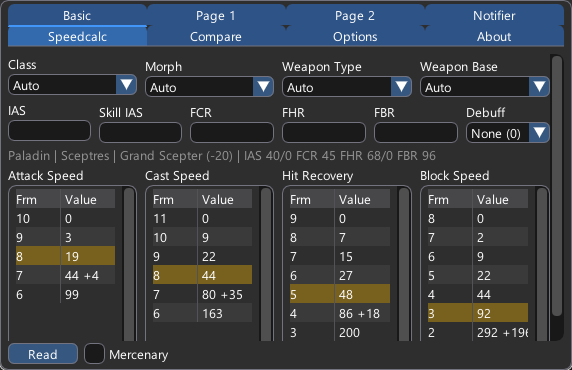
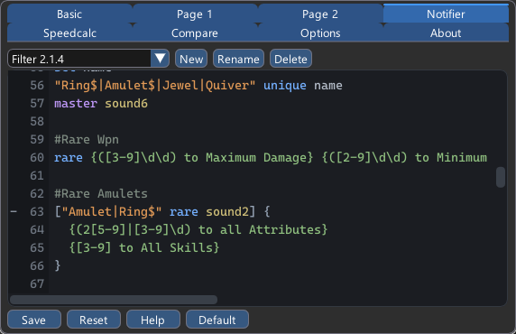
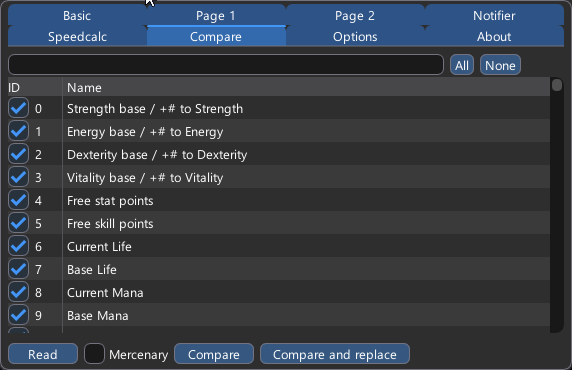
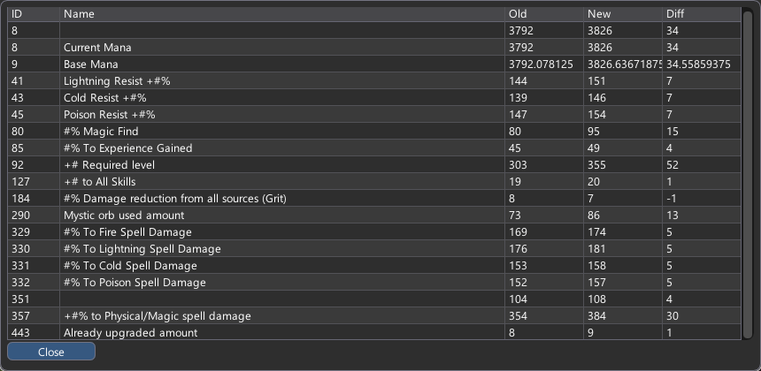

# D2Stats

## Features
- Read character/mercenary stats
- Check difference in stats between 2 states (Click 'Read' to snapshot stats. After modifying stats, click 'Diff' to compare without changing the snapshot, or 'Diff and replace' to compare and then overwrite the snapshot)
- Set up rule list that check drops and notify the user when matching one drops
- Play sound notification when goblin appears

[Forum post](https://forum.median-xl.com/viewtopic.php?f=4&t=85654)

## Screenshots

**Character and item stats**





**Options**




**Tools**






## FAQ
### "Windows defender/Antivirus removes/quarantines the exe file. Is it a virus?"
This tool attaches itself to the `Game.exe` process and modifies memory to function properly. Due to this behaviour (and also frequent updates and small user pool) antivirus software label it as trojan. There is nothing i can do to fix it and i can only recommend to add .exe file to ignore/exception list.

### "Why can't i hide items using D2Stats?"
Mod version 2.10 introduced in-game loot filtering system that disabled filtering using D2Stats. Current version only allows for notifying when certain item drops. All filters that still have `hide` and `show` keywords need to have them removed for notifier to function properly

### "Why does the notifier overlay look so ugly. Can i modify it eg change font style or background transparency/color?"
The overlay is an ImGui layered window (per-pixel alpha) drawn by `d2stats_ui.dll`. Exposed options:
  - Font (Options combo of **monospace** fonts installed on this machine)
  - Font size
  - X and Y offset (in pixels) from top-left edge of the window
  - Notification timeout duration (in milisecond)
  - Contrast background behind overlay text

The font list comes from Windows/GDI, so Wine/Linux users only see fonts available in that Wine prefix. Install `corefonts` (`winetricks corefonts`) or copy `.ttf` files into Wine's `Fonts` folder if the combo is empty or missing Courier New / Consolas. Wine also needs a working D3D11 path (DXVK) for the overlay.

If you really want to change some properties that were not exposed on the application UI you'll have to edit the overlay/UI code (`native/d2stats_ui/` and `src/Overlay.au3`) and recompile it using provided script (`Compile.bat`)

## Notifier rules
Rules are stored as `NotifierRules\*.rules` files and edited in the **Notifier** tab. The editor is syntax aware:

- Keywords, `"item name"` patterns, `{stat patterns}` and `# comments` are colorized on a near-black surface. Unknown keywords get a red dotted underline plus a tooltip with the closest matching flag.
- Autocomplete pops up while typing or on `Ctrl+Space`. `Tab`/`Enter` inserts the highlighted entry, `Esc` closes the list, the mouse wheel walks a long list.
  - Keywords come from the flag table, item names from the in-game item cache **and** from the quoted patterns of every rule file, so unique/set names you already filter on are suggested before you are in a game.
- The editor has its own font and size settings under Options → Notifier editor (they default to the overlay values but can differ).
- The `stat` flag prints the item stats below the name; their text size is a separate setting, **Options → Overlay → Stat text size** (percentage of the overlay font, 100% by default). It is disabled while the notifier is off.
- `Ctrl+S` saves the file, `Ctrl+Z` / `Ctrl+Y` undo and redo, `Tab` indents the selected lines, `Shift+Tab` unindents. `Enter` inserts a plain newline, no automatic indentation.
- Socket filters: `socketed0` … `socketed6` match an exact socket count, `socketed_any` matches any count (handy to override a socket filter inherited from a group).
- Groups share one set of attributes between several rules. The header is a rule without a body — it may carry a name pattern, flags and `{stat}` patterns:

```
["Amulet|Ring$" rare sound2] {
  {(2[5-9]|[3-9]\d) to all Attributes}
  {[3-9] to All Skills}
}
```

Every line inside `[ ... ] { ... }` becomes one rule and inherits whatever it does not specify itself: a line may be only stat patterns, only flags or only a name. Header `{stat}` patterns have to match **in addition to** the line's own patterns, and a flag written on the line replaces the header's value for that flag group (tier, quality, eth, socket, color, sound). A group may be closed with `}` or `} ]`; groups cannot be nested.

The rule editor — autocomplete, keyword highlighting and the grouping were heavily influenced by the notifier editor of [D2MXLUtils](https://github.com/synonymouse/D2MXLUtils).

## Layout
- `D2Stats.au3` — application entry point (keep at repo root so runtime files stay beside the exe)
- `src/` — feature modules (game memory, notifier, AutoIt bridge to ImGui)
- `native/d2stats_ui/` — Dear ImGui settings window and transparent overlay (`d2stats_ui.dll`, 32-bit)
- `Sounds/` — notifier audio, shipped next to the exe
- `Assets/` — icon and README screenshots
- `vendor/` — bundled AutoIt interpreter, compiler, and UDFs
- `tools/` — version stamp, release packaging, and speedcalc data update

Building requires CMake and a 32-bit MSVC toolset in addition to AutoIt. `Compile.bat` builds `d2stats_ui.dll` then `D2Stats.exe`. Ship both next to `Sounds/`.
